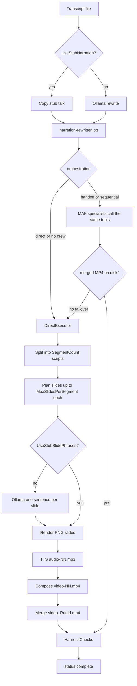
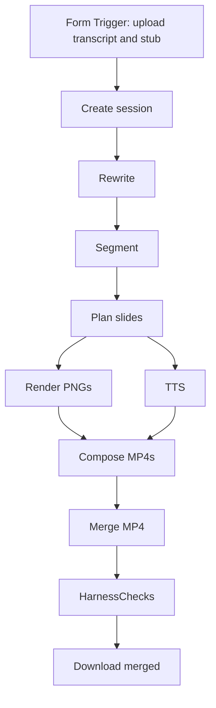

# Narration Studio

A Visual Studio 2026 / .NET 10 boilerplate for [Microsoft Agent Framework](https://learn.microsoft.com/en-us/agent-framework/overview/). Specialized agents use tools, memory, context, and guardrails to turn `voice_transcript.txt` into a synced narration video.

## Workflow

Caps come from `Studio:` (`SegmentCount`, `MaxSlidesPerSegment`, `TargetTalkMinutes`). Stub flags skip Ollama. Diagrams: `docs/n8n-service.md`, `docs/diagrams/studio-factory.svg`, `docs/diagrams/n8n-job.svg`.



n8n is the loop. Form Trigger → Create session → one node per factory stage → download. Windows `ProductionTools` still writes every PNG / MP3 / MP4:



Artifacts land in `output/` (CLI) or `output/jobs/{jobId}/` (n8n).

## Agents

| Agent | Role | Hands off to |
| --- | --- | --- |
| `coordinator` | Reads pipeline status and routes work | specialists below |
| `narration_rewriter` | Ollama rewrite of the raw transcript into a 7-minute talk | `script_segmenter` or coordinator |
| `script_segmenter` | 8 narration scripts from the rewritten talk | coordinator |
| `slide_planner` | ≤5 phrases per segment | `image_renderer` or coordinator |
| `image_renderer` | PNG slides with on-screen text | coordinator |
| `tts_producer` | `audio-01.mp3` … `audio-08.mp3` | coordinator |
| `video_composer` | per-segment MP4s + timestamped merge | coordinator |

Each agent has tools, a shared `ProductionContextProvider`, file memory under `output/agent-file-memory`, and middleware guardrails (blocked topics, PII redaction, 8-script / 5-slide caps).

## Run

Open `NarrationStudio.slnx` in Visual Studio 2026.

**HTTP service** (n8n / Docker). Empty args listen on `http://0.0.0.0:5088`. Optional job API key: `docs/n8n-service.pdf` §3.1. How n8n is used, including the Docker Compose additions: `docs/n8n-service.pdf`. Architecture: `docs/NarrationStudio-Internal-Workings.pdf` §19.

```powershell
cd E:\exercises\maf
dotnet run --project src\NarrationStudio
```

**CLI production:**

```powershell
cd E:\exercises\maf
dotnet run --project src\NarrationStudio -- --orchestration direct
```

Orchestration modes:

- `--orchestration handoff` (default when an LLM is configured) — coordinator hands work to specialists
- `--orchestration sequential` — Ollama rewrite → scripts → slides → images → TTS → video
- `--orchestration direct` — same tools in order, including the Ollama rewrite

Pass a transcript path as the first argument if it is not `voice_transcript.txt` in the working directory.

## Configuration

`src/NarrationStudio/appsettings.json` plus environment variables / user secrets:

| Setting | Purpose |
| --- | --- |
| `Model:Endpoint` | Ollama base URL, default `http://localhost:11434` |
| `Model:Model` | Ollama model, default `qwen3.8:latest` |
| `Model:TimeoutMinutes` | Ollama request timeout, default `30` |
| `Studio:TargetTalkMinutes` | Spoken length of the rewritten talk, default `7` |
| `OPENAI_API_KEY` | Optional OpenAI models for specialist orchestration (Ollama is used if unset) |
| `OPENAI_MODEL` | Defaults to `gpt-4o-mini` |
| `AZURE_OPENAI_ENDPOINT` | Optional Azure OpenAI endpoint |
| `AZURE_OPENAI_API_KEY` | Optional Azure key |
| `AZURE_OPENAI_DEPLOYMENT_NAME` | Azure deployment name |
| `ELEVENLABS_API_KEY` | Real TTS; otherwise Windows SAPI (then ffmpeg → MP3) |

The rewrite step currently uses `voice_transcript_ollama.txt` as a stub (`Studio:UseStubNarration` = true). That file is copied into `output/scripts/narration-rewritten.txt` **before** any agent or Ollama call. Set the flag to `false` to call Ollama again.
