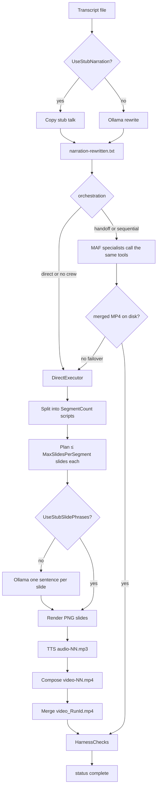
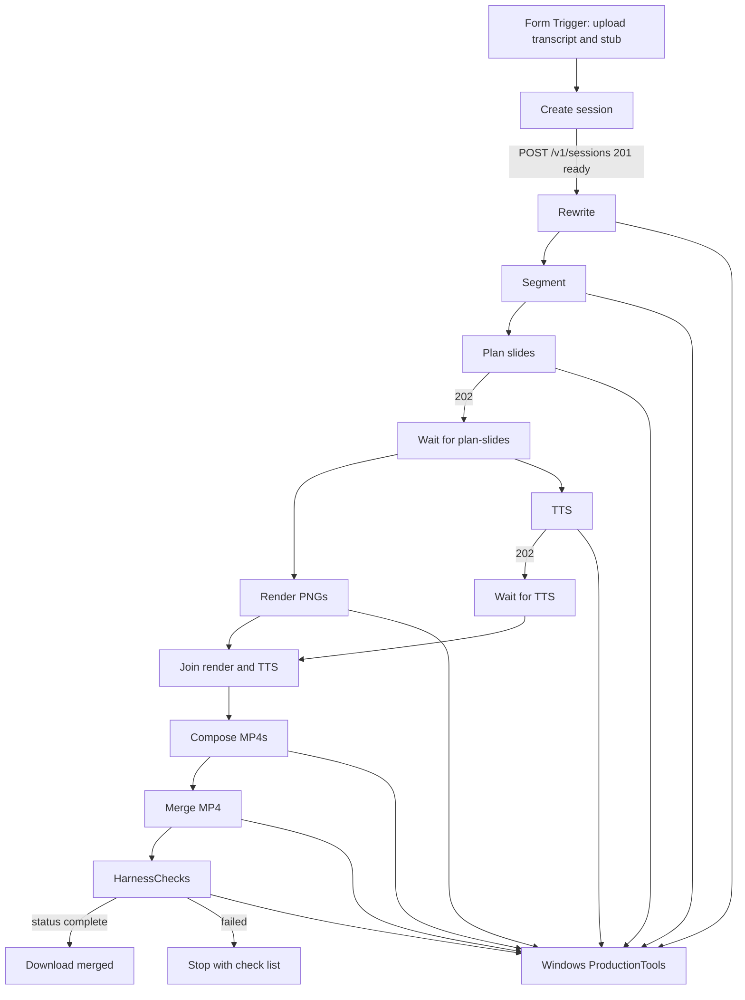

# Narration Studio as an n8n service

This note records **what was built on 22–23 Aug 2026**, the decisions that shaped it, and how to operate it now. n8n is the **loop**: each factory stage is a node. The Windows process is a sidecar that still owns every PNG / MP3 / MP4 write through `ProductionTools`. Printable copy: [`docs/n8n-service.pdf`](n8n-service.pdf). Architecture context: [`docs/NarrationStudio-Internal-Workings.pdf`](NarrationStudio-Internal-Workings.pdf) §19.

## What was asked

Expose Narration Studio as a **service for n8n**, with a **custom node** whose fields come from `src/NarrationStudio/appsettings.json`. `StubNarrationPath` (and the transcript) had to be supplied by **browsing for a file**, not by typing a Windows path.

Constraints that followed:

- n8n already runs in **Docker on the same PC** (stack `n8n-api_icountera`, UI on port **5678**). The container cannot see `E:\…` paths.
- Studio must stay a **Windows process** so it can use ffmpeg, SAPI, and Ollama on `localhost:11434`.
- A full video run is longer than n8n’s default HTTP timeout. The product path is one HTTP step per tool. Only `plan-slides` and `tts` return **202** and need a Wait poll. `POST /v1/jobs` remains a compatibility “run all”.
- Production stays **one job at a time** (Ollama / ffmpeg / ElevenLabs). Jobs write under `output/jobs/{jobId}/` so one run cannot wipe another.
- API keys stay off the public form.

Both a **custom node** and a **Form Trigger** sample were shipped.

## Decisions

| Choice | Result |
| --- | --- |
| Where n8n runs | Existing Docker stack; Studio is not containerized |
| How Docker reaches Studio | `http://host.docker.internal:5088` |
| How “browse file” works | n8n Form Trigger upload → node embeds text → Studio writes `output/jobs/{id}/inputs/` |
| CLI vs service | Empty args (or `--service`) start Kestrel. `--orchestration` still runs the CLI and exits |
| Defaults | Form / node fields pre-filled from `appsettings.json`. Server overlays only supplied values |
| Caps | Still `Studio:SegmentCount`, `MaxSlidesPerSegment`, `TargetTalkMinutes` — not hardcoded in prompts |
| Not on the form | `ElevenLabsApiKey` (credential), `OutputDirectory` (server sets `output/jobs/{id}`) |
| Community npm install | **Do not use.** `n8n-nodes-narration-studio` is this repo, not the public registry |

## Workflows

### Narration Studio factory

Same tool sequence for CLI (`--orchestration`) and for an HTTP job. Caps come from `Studio:` (`SegmentCount`, `MaxSlidesPerSegment`, `TargetTalkMinutes`). All PNG / MP3 / MP4 writes go through `ProductionTools`. SVG: [`docs/diagrams/studio-factory.svg`](diagrams/studio-factory.svg).



CLI entry: `dotnet run --project src\NarrationStudio -- --orchestration direct` (or handoff / sequential). Empty args do **not** run this loop; they start Kestrel.

### n8n calling Narration Studio

n8n is the loop. Each stage node calls one Windows step. PNG / MP3 / MP4 writes stay on `ProductionTools`. SVG: [`docs/diagrams/n8n-job.svg`](diagrams/n8n-job.svg).



`POST /v1/jobs` + `JobWorker` is still available as a compatibility black-box run. Compose / merge / rewrite still take mutex `NarrationStudio.Production`. **Render** and **TTS** may run at the same time on one session (different folders); Wait For Step polls `steps[step]`, not the single `currentStep` field.

Optional credential on every Studio node except the Form Trigger sends `X-Api-Key`.

## What shipped

### Windows job API

Empty `dotnet run --project src\NarrationStudio` from the **repo root** starts Kestrel on `Service:ListenUrl` (`http://0.0.0.0:5088`). Pipeline types are **scoped** per job or session. `JobWorker` still runs compatibility `POST /v1/jobs`. `StepWorker` runs long session steps (`plan-slides`, `tts`). Both take mutex `NarrationStudio.Production`.

`JobOptionsMerger` clones `Studio:` / `Model:` from the **bin** `appsettings.json` and overlays the request. `undefined` / `null` strings from n8n expressions are ignored.

`Service:ApiKey` empty → unauthenticated API (warning in the log). Clients send a key as `X-Api-Key` when set.

Optional create headers (never form fields): `X-ElevenLabs-Api-Key`, `X-OpenAI-Api-Key`, `X-Azure-OpenAI-Api-Key`.

### Custom node

Package: [`n8n/n8n-nodes-narration-studio`](../n8n/n8n-nodes-narration-studio). Shipped as JS in `dist/` (no TypeScript build). Node versions **2 and 3** share the same code.

Operations: **Create Session**, one op per step (**Rewrite**, **Segment**, **Plan Slides**, **Render**, **TTS**, **Compose**, **Merge**, **Verify**), **Wait For Step**, plus existing **Get Status** / **Wait Until Complete** / **Download Merged Video**. **Start Job** remains the compatibility “run all”. Node versions **2, 3, and 4** share the same code.

Credentials (**Narration Studio API**) are optional. With none selected the node calls `http://host.docker.internal:5088`.

Start Job POSTs **JSON** with real booleans/numbers and embeds uploads as `transcriptText` / `stubNarrationText`. Binary keys accepted include `transcript`, `Transcript_file`, `stubNarration`, `Stub_narration_file`, and `Dub_narration_file` (Form Trigger names the binary after the field **label**).

### Form workflow

[`n8n/workflows/narration-studio-form.json`](../n8n/workflows/narration-studio-form.json): Form Trigger → Create session → Rewrite → Segment → Plan slides → Wait → **Render and TTS in parallel** → Join → Compose → Merge → Verify → Download. On `verify` failure the workflow stops with the harness check list. Success is `status == complete` plus files on disk.

Every field has a **label** and a hint with the config key (`Studio:SegmentCount`, `Model:Endpoint`, …). Numeric/text/dropdown defaults match `appsettings.json`. File fields cannot be pre-filled.

### Tests

`JobOptionsMergerTests`, `JobPathsTests`, `JobRequestJsonTests` (string `"true"` / `"4"` deserialize as bool/int), plus `SessionStepsTests`, `SessionStepGateTests`, `SessionIsolationTests`, and `PipelineSegmentPatchTests` (step routing, render+TTS fan-out, per-session folders, slide persist that keeps audio paths).

## API

| Method | Path | Notes |
| --- | --- | --- |
| GET | `/health` | No API key |
| POST | `/v1/sessions` | JSON **or** multipart. Returns **201** `{ jobId, status: ready }`. No `JobWorker` enqueue. Sessions use orchestration `direct`. |
| POST | `/v1/sessions/{id}/steps/{step}` | One `ProductionTools` / `HarnessChecks` call. Short steps **200**. `plan-slides` and `tts` **202**; poll `GET /v1/jobs/{id}` until `stepStatus` is `complete` or `failed`. Status includes `currentStep` / `stepStatus` / `stepResult`. |
| POST | `/v1/jobs` | Compatibility run-all. Returns **202** `{ jobId, status: queued, … }` |
| GET | `/v1/jobs/{id}` | `queued` / `ready` / `running` / `complete` / `failed` plus `currentStep` / `stepStatus` / `steps` (per-step map for fan-out) |
| GET | `/v1/jobs/{id}/events` | `events.jsonl` lines |
| GET | `/v1/jobs/{id}/artifacts/merged` | MP4 download |

Steps: `rewrite`, `segment`, `plan-slides`, `render`, `tts`, `compose`, `merge`, `verify`. Unknown step is **400**. A full `POST /v1/jobs` id is **409** on the session step route. Two n8n executions cannot run a step on the same session at once (**409**).

JSON body fields include `title`, `orchestration`, stub flags, segment/slide/talk caps, Ollama endpoint/model/timeout, OpenAI/Azure model names, ElevenLabs voice/model ids, video size, `rewriteExtraInstructions`, `callbackUrl`, `keepArtifacts`, plus `transcriptText` / `stubNarrationText`.

Multipart still accepts files named `transcript`, `Transcript_file`, `stubNarration`, `Stub_narration_file`, `Dub_narration_file`. Booleans and ints may arrive as strings (`"true"`, `"8"`). Bad JSON is **400**, not 500.

If no upload or `transcriptText` is sent, Studio copies `voice_transcript.txt` from the working directory when that file exists. Stub narration is required when `UseStubNarration` is true unless `voice_transcript_ollama.txt` (or `Studio:StubNarrationPath`) is already on disk.

## Run the service

From the repo root:

```powershell
cd E:\exercises\maf
dotnet run --project src\NarrationStudio
```

Or F5 the `NarrationStudio` launch profile (empty args). Only **one** process may hold `NarrationStudio.exe`. A second `dotnet run` fails with MSB3027 (file locked). Stop the listener on port 5088 before rebuilding.

CLI production is unchanged:

```powershell
dotnet run --project src\NarrationStudio -- --orchestration direct
```

`dotnet run` from repo root binds the **bin** copy of `appsettings.json`.

Ollama URLs are from the **Windows host**, not from inside the n8n container. Allow port **5088** in Windows Firewall if the container cannot connect.

## Job API key (optional)

There is no generate-key endpoint. You mint a random string, store the **same** value on Studio and in the n8n credential, then restart the service. Credentials on the custom node stay **optional** until you set a key. `/health` never requires it. Other routes then need header `X-Api-Key`. A mismatch is **401**.

**1. Create a secret** (PowerShell):

```powershell
[Convert]::ToBase64String((1..32 | ForEach-Object { Get-Random -Maximum 256 }) -as [byte[]])
```

A GUID is enough for local use: `[guid]::NewGuid().ToString("N")`.

**2. Put it on Studio.** `dotnet run` binds the **bin** copy:

`src/NarrationStudio/bin/Debug/net10.0-windows/appsettings.json`

```json
"Service": {
  "ListenUrl": "http://0.0.0.0:5088",
  "ApiKey": "paste-the-secret-here"
}
```

Prefer not committing it. Keep source `ApiKey` empty and set an environment variable before `dotnet run`:

```powershell
$env:Service__ApiKey = "paste-the-secret-here"
```

Stop and start Studio so the new value loads.

**3. Put it on n8n.** This is only n8n storing a secret and attaching it to the Studio nodes. It is not a form field.

A **Narration Studio API** credential is one vault record:

| Field on the credential | What it is | What Studio does with it |
| --- | --- | --- |
| **Base URL** | Where Docker n8n calls Windows | Default `http://host.docker.internal:5088` — the host’s port 5088, not `localhost` inside the container |
| **API Key** | Same string as `Service:ApiKey` | HTTP header `X-Api-Key` on job calls. Not required for `/health` |
| **ElevenLabs / OpenAI / Azure API Key** | Vendor keys | Other headers (`X-ElevenLabs-Api-Key`, …). **Not** `Service:ApiKey` |

Create it: n8n → **Credentials** → **Add credential** → search **Narration Studio API** (from the mounted custom node, not public npm). Set Base URL to `http://host.docker.internal:5088`. Set **API Key** to the exact Studio string (no extra space or quotes). Leave vendor keys blank unless you want those headers. Save. **Test** hits `GET /health` and only proves the URL is reachable, not that the job key is correct.

Attach it on all three nodes that call Studio. The sample workflow is Form → **Create session** → stage nodes → **Download merged video**. Open every Narration Studio node except the Form Trigger, set **Credential** to the record you saved, and save the workflow. If only Create session has it, later stages get **401**. **On form submission** does not get this credential.

On each request the node uses the credential Base URL (or falls back to `http://host.docker.internal:5088`) and, if **API Key** is non-empty, sends `X-Api-Key`. Studio compares that header to `Service:ApiKey` with an exact match. Empty Studio key → any request is allowed. Set Studio key + missing/wrong header → **401** `{ "error": "Missing or invalid X-Api-Key." }`.

Do not put `Service:ApiKey` on the Form Trigger. That URL is shareable; the job key is a server-to-server secret (n8n encrypts credentials with `N8N_ENCRYPTION_KEY`). Segment count, Ollama model, voice id stay on the form.

Putting an ElevenLabs key in **API Key** will not unlock TTS, and will 401 the job API if it does not match `Service:ApiKey`. After you change the Studio key, restart `dotnet run` and update the n8n credential. You do not need to re-import the workflow unless a node still has no credential selected.

## Docker Compose file (this PC)

Live file: `E:\icountera\n8n-api_icountera\n8n\docker-compose.yml`  
Sanitized copy in this repo (ADDED lines commented): [`n8n/docker-compose.n8n-excerpt.yml`](../n8n/docker-compose.n8n-excerpt.yml).

Always compose with `-p n8n-api_icountera`. A compose up **without** that project name created a second stack that collided on port 5678; that extra stack was torn down. Do not paste `.env` passwords into tickets.

### What was already there vs what was added

| Already on the stack | Added for Narration Studio |
| --- | --- |
| `postgres:16` + `n8n_data` / `postgres_data` | `N8N_CUSTOM_EXTENSIONS: /custom-nodes/n8n-nodes-narration-studio` |
| `docker.n8n.io/n8nio/n8n:latest` on **5678** | `N8N_UNVERIFIED_PACKAGES_ENABLED: "true"` |
| Postgres env + `N8N_ENCRYPTION_KEY` from `.env` | `extra_hosts: host.docker.internal:host-gateway` |
| Existing n8n env (`N8N_HOST`, `WEBHOOK_URL`, runners, …) | Volume `E:/exercises/maf/n8n/n8n-nodes-narration-studio` → `/custom-nodes/n8n-nodes-narration-studio:ro` |
| | One-time `npm install` of that folder under `/home/node/.n8n/nodes` |

n8n **service** after the addition (secrets remain `${…}`):

```yaml
  n8n:
    image: docker.n8n.io/n8nio/n8n:latest
    restart: unless-stopped
    ports:
      - "5678:5678"
    environment:
      # … existing DB / encryption / host keys unchanged …
      N8N_CUSTOM_EXTENSIONS: /custom-nodes/n8n-nodes-narration-studio   # ADDED
      N8N_UNVERIFIED_PACKAGES_ENABLED: "true"                          # ADDED
    extra_hosts:
      - "host.docker.internal:host-gateway"                            # ADDED
    volumes:
      - n8n_data:/home/node/.n8n
      - E:/exercises/maf/n8n/n8n-nodes-narration-studio:/custom-nodes/n8n-nodes-narration-studio:ro  # ADDED
    depends_on:
      postgres:
        condition: service_healthy
```

Apply, install, restart:

```powershell
cd E:\icountera\n8n-api_icountera\n8n
docker compose -p n8n-api_icountera up -d
docker compose -p n8n-api_icountera exec n8n sh -c "mkdir -p /home/node/.n8n/nodes && cd /home/node/.n8n/nodes && npm install /custom-nodes/n8n-nodes-narration-studio"
docker compose -p n8n-api_icountera restart n8n
```

**Install community nodes** with the npm name hits the **public** registry. Do not use it for this package.

| Item | Value |
| --- | --- |
| Compose project | `n8n-api_icountera` |
| Compose dir | `E:\icountera\n8n-api_icountera\n8n` |
| n8n UI | `http://localhost:5678` |
| From n8n → Studio | `http://host.docker.internal:5088` |
| Install | `npm install /custom-nodes/n8n-nodes-narration-studio` under `/home/node/.n8n/nodes` |

### Update the Narration Studio node

The volume is live (read-only in the container, writable on Windows). Edit `n8n/n8n-nodes-narration-studio/dist/…` in this repo.

| Change | What to run |
| --- | --- |
| JS / credentials / SVG only | `docker compose -p n8n-api_icountera restart n8n` then **Ctrl+Shift+R** in the editor |
| `package.json` name/files/`n8n` block | `npm install` again (same exec line as above), then restart + hard-refresh |
| Workflow JSON | Re-import `n8n/workflows/narration-studio-form.json` |

Do not `docker compose up` without `-p n8n-api_icountera`.

### Add another custom node (another “agent”) to the same compose

Treat each n8n community package as its own folder, same shape as `n8n-nodes-narration-studio` (`package.json` with an `n8n` key, `dist/` nodes + credentials).

1. Create `E:\exercises\maf\n8n\n8n-nodes-<name>\` (do not put it next to `workflows` as a random file — n8n loads **packages**).
2. In `docker-compose.yml`, add a volume and append the path. In the **Linux** container, separate multiple `N8N_CUSTOM_EXTENSIONS` folders with a **colon**:

```yaml
      N8N_CUSTOM_EXTENSIONS: /custom-nodes/n8n-nodes-narration-studio:/custom-nodes/n8n-nodes-<name>
      N8N_UNVERIFIED_PACKAGES_ENABLED: "true"
    extra_hosts:
      - "host.docker.internal:host-gateway"
    volumes:
      - n8n_data:/home/node/.n8n
      - E:/exercises/maf/n8n/n8n-nodes-narration-studio:/custom-nodes/n8n-nodes-narration-studio:ro
      - E:/exercises/maf/n8n/n8n-nodes-<name>:/custom-nodes/n8n-nodes-<name>:ro
```

3. Recreate the container so env + mounts apply, then install the new package:

```powershell
cd E:\icountera\n8n-api_icountera\n8n
docker compose -p n8n-api_icountera up -d
docker compose -p n8n-api_icountera exec n8n sh -c "cd /home/node/.n8n/nodes && npm install /custom-nodes/n8n-nodes-<name>"
docker compose -p n8n-api_icountera restart n8n
```

4. Hard-refresh n8n. The new node appears in the palette. Point it at `http://host.docker.internal:<port>` if it also calls a Windows process.

Do **not** mount the whole `n8n/` folder as `N8N_CUSTOM_EXTENSIONS` — that folder also contains `workflows/` and the compose excerpt, which are not node packages.

This is an **n8n node**, not a MAF specialist. New Narration Studio agents still go in `src/NarrationStudio/Agents/` and `ProductionTools` — they do not belong in docker-compose.

## Form fields vs appsettings

Shown on the form / node: title, orchestration, stub flags, transcript and stub file uploads, Model endpoint/model/timeout, segment/slide/talk caps, OpenAI/Azure model names (not keys), ElevenLabs voice/model ids, video size, rewrite extra instructions, keep artifacts, callback URL (node only).

**Not on the form:** `ElevenLabsApiKey` / other secrets (credential or `appsettings`), `OutputDirectory` (always `output/jobs/{id}`).

## What went wrong (and the fix)

1. **Public npm install** — n8n’s “Install community nodes” dialog does not see this repo. Mount + local `npm install` instead.
2. **“Node does not have any credentials set”** — credentials were made optional; default base URL is `host.docker.internal:5088`.
3. **Start job 500** — the node sent JSON with string booleans (`"true"`). `System.Text.Json` rejected `$.useStubNarration`. Form binaries were named `Transcript_file` / `Stub_narration_file`, so files never arrived. Fix: flexible bool/int converters, `transcriptText` / `stubNarrationText`, binary-name aliases, JSON parse failures → **400**.
4. **MSB3027 file lock** — two `dotnet run` instances. Stop the process on port 5088 before building or starting another.

## Curl smoke test

```powershell
curl http://localhost:5088/health
curl -X POST http://localhost:5088/v1/sessions -H "Content-Type: application/json" -d "{\"useStubNarration\":true,\"transcriptText\":\"hello from curl\",\"stubNarrationText\":\"hello stub\"}"
curl -X POST http://localhost:5088/v1/sessions/{id}/steps/rewrite
curl -X POST http://localhost:5088/v1/jobs -H "Content-Type: application/json" -d "{\"orchestration\":\"direct\",\"useStubNarration\":true,\"transcriptText\":\"hello from curl\",\"stubNarrationText\":\"hello stub\"}"
```

Multipart still works:

```powershell
curl -X POST http://localhost:5088/v1/jobs -F "orchestration=direct" -F "useStubNarration=true" -F "transcript=@voice_transcript.txt" -F "stubNarration=@voice_transcript_ollama.txt"
```
